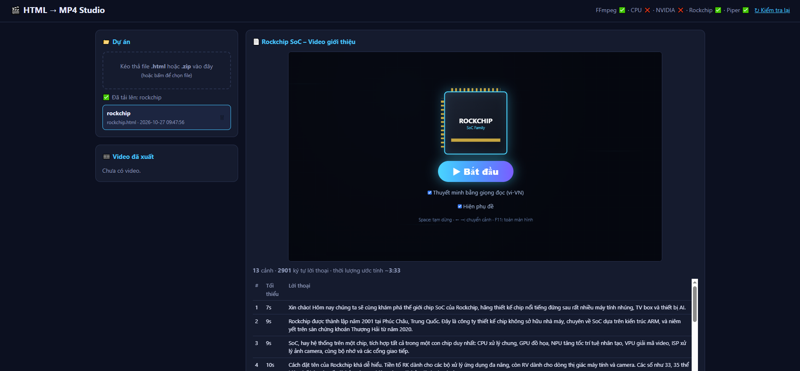

# 🎬 HTML2Video

> Runs on Orange Pi Rockchip 3588 · [Tiếng Việt](README.md) · [Screenshots](screenshot.md)

Turn a **scene-based animated HTML page** plus **TTS** into an **MP4**. Web UI, parallel Chromium workers, encoders for **CPU / NVIDIA NVENC / Rockchip MPP**. Tuned for **Orange Pi 5 Plus (RK3588)**; also runs on Linux x86_64 or ARM64.



Full gallery: **[screenshot.md](screenshot.md)**

---

## Contents

1. [Features](#1-features)
2. [Pipeline](#2-pipeline)
3. [HTML input](#3-html-input)
4. [Layout](#4-layout)
5. [Install](#5-install)
6. [Configuration](#6-configuration)
7. [Usage](#7-usage)
8. [Performance & troubleshooting](#8-performance--troubleshooting)
9. [Security & limits](#9-security--limits)

---

## 1. Features

- Upload `.html` / `.zip` (HTML + assets); one folder per project; **delete project** in the UI
- Aspect-correct preview; scene list / dialogue / estimated duration
- **Light / dark** theme toggle
- **TTS:** Edge (online), **ElevenLabs** / **VieNeu** (online, API key required) or offline **Piper** (one warm in-process model, serial synth)
- Aspects **16:9 / 9:16 / 4:3**, 720p–4K, FPS 24/25/30/60
- Burned-in captions + always export `.srt`
- Encoders: `libx264`/`libx265`, NVENC, `h264_rkmpp`/`hevc_rkmpp` — auto-detected
- Parallel Chromium capture; job queue, progress, cancel, **delete job** (MP4/SRT + `build/`)

---

## 2. Pipeline

```
Browser → Flask (app.py) → queue (1 job at a time) → renderer.py
  ① Parse     Chromium reads .scene[data-say][data-t]
  ② TTS       Edge/ElevenLabs/VieNeu low-parallel + staggered · Piper warm + serial
  ③ Render    N Chromium workers · seek CSS animation · JPEG → ffmpeg → .ts
  ④ Mux       concat (-c:v copy) + AAC audio → MP4 + SRT
```

This is **not** realtime screen recording. Each frame `g` is seeked via the Web Animations API (`currentTime`), so slow hosts still hit the target FPS and work can be split across Chromiums.

**Input motion:** **CSS animation / transition only**. Not seekable: `requestAnimationFrame`, canvas/WebGL, GSAP, `<video>`, GIF.

---

## 3. HTML input

Each scene: `class="scene"`, `data-say` (TTS text, may be empty), `data-t` (minimum duration, seconds). The active scene gets class `active`.

```html
<section class="scene" data-t="5" data-say="Hello everyone.">
  <h1 class="a">Title</h1>
</section>
<style>
  .scene{position:absolute;inset:0;opacity:0}
  .scene.active{opacity:1}
  .a{opacity:0}
  .scene.active .a{animation:up .8s forwards}
  @keyframes up{from{opacity:0;transform:translateY(40px)}to{opacity:1;transform:none}}
</style>
```

If the page advances scenes itself:

```js
if (!navigator.webdriver) { /* auto slideshow */ }
```

Full example: `examples/demo.html`. ZIP uploads prefer `index.html` and relative asset paths.

---

## 4. Layout

```
html2video/
├── app.py / renderer.py / bench.py
├── install.sh / run.sh / .env.example
├── static/index.html
├── scripts/          # ffmpeg-rockchip, perf-mode, get-piper-voice
├── examples/demo.html
├── voices/           # Piper *.onnx + *.onnx.json
├── uploads/ outputs/ build/
├── screenshots/      # UI images
├── screenshot.md
├── README.md         # Vietnamese
└── README-en.md      # English (this file)
```

---

## 5. Install

### 5.1 Orange Pi 5 Plus (RK3588)

- Fan + heatsink; adequate PSU; NVMe recommended
- **Rockchip BSP** kernel (with `/dev/mpp_service`) for Rockchip encode

```bash
uname -r
ls -l /dev/mpp_service /dev/rga /dev/dri

# Optional rkmpp FFmpeg (20–40 min)
bash scripts/build-ffmpeg-rockchip.sh
# then in .env: FFMPEG_BIN=/usr/local/bin/ffmpeg , FFPROBE_BIN=/usr/local/bin/ffprobe

./install.sh --service
sudo systemctl status html2video
# or: ./install.sh && ./run.sh
```

Open `http://<IP>:5000` → status should show `FFmpeg ✅`. Upload `examples/demo.html` and try 720p.

Optional offline Piper:

```bash
bash scripts/get-piper-voice.sh
```

Click **↻ Recheck**. Prefer `piper-tts` in `.venv` (warm model). `PIPER_BIN` is native fallback only.

### 5.2 Other Linux (CPU / NVIDIA)

```bash
./install.sh --service
```

NVIDIA: driver + FFmpeg with `nvenc`; keep worker count ≤ NVENC session limits. Docker/VM: `--shm-size=2g` (or `--ipc=host`).

---

## 6. Configuration

Edit `.env` (from `.env.example`), then `sudo systemctl restart html2video`.

| Variable | Default | Meaning |
|---|---|---|
| `HOST` / `PORT` | `0.0.0.0` / `5000` | Web bind |
| `FFMPEG_BIN` / `FFPROBE_BIN` | `ffmpeg` / `ffprobe` | FFmpeg paths |
| `PIPER_BIN` | `piper` | Native fallback |
| `PIPER_CONCURRENCY` | `1` | **Keep 1 on RK3588** — parallel ONNX often hard-reboots |
| `PIPER_ORT_THREADS` / `PIPER_OMP_THREADS` | `2` / `2` | ORT/OpenMP threads |
| `EDGE_CONCURRENCY` | `2` | Parallel Edge TTS requests (keep low to avoid throttling) |
| `EDGE_STAGGER` | `0.4` | Seconds to spread Edge requests (0 = off) |
| `ELEVENLABS_API_KEY` | — | ElevenLabs API key (enables the ElevenLabs option) |
| `ELEVENLABS_VOICE_ID` | `21m00Tcm4TlvDq8ikWAM` | Default voice ID |
| `ELEVENLABS_MODEL_ID` | `eleven_multilingual_v2` | Model (supports Vietnamese) |
| `ELEVENLABS_CONCURRENCY` | `1` | Parallel ElevenLabs requests (keep 1 on free tier) |
| `VIENEU_BASE_URL` | instabox sample URL | VieNeu-TTS server base URL |
| `VIENEU_API_KEY` | — | VieNeu bearer token (enables the VieNeu option) |
| `VIENEU_MODEL` | `vieneu-v3-nano` | VieNeu model |
| `VIENEU_VOICE` | `Mai Anh` | Default voice (preset) |
| `VIENEU_CONCURRENCY` | `1` | Parallel VieNeu requests |
| `CHROMIUM_ARGS` / `CHROMIUM_GPU_ARGS` | — | Chromium flags |

---

## 7. Usage

### 7.1 Web UI

1. Upload / select a project (**Delete** removes `uploads/<id>/`)
2. Choose TTS (**Edge · Piper · ElevenLabs · VieNeu**), voice, rate, aspect, resolution, encoder…
3. **Render MP4** → watch the **queue** (Cancel / Delete job / download MP4·SRT)
4. Toggle light/dark theme in the header

### 7.2 Via API

Everything the UI does is available over REST: upload & select a project, read the scene list and
estimated duration, render with every option (TTS + new voices, rate, aspect, resolution, encoder…),
track the queue, and **get the MP4/SRT download link**.

➡️ **Full docs: [API-en.md](API-en.md)** — parameter tables, error codes, end-to-end Bash and Python examples.

Minimal flow:

```bash
BASE=http://localhost:5000

# 1) Upload → project id
PID=$(curl -s -F file=@examples/demo.html "$BASE/api/upload" | jq -r .id)

# 2) Render → job id
JID=$(curl -s -X POST "$BASE/api/render" -H 'Content-Type: application/json' -d "{
  \"project\": \"$PID\", \"tts\": \"vieneu\", \"voice\": \"Mai Anh\", \"rate\": 5,
  \"aspect\": \"9:16\", \"resolution\": \"1080p\", \"fps\": 30,
  \"subtitles\": true, \"encoder\": \"rockchip\", \"codec\": \"h264\", \"workers\": 0
}" | jq -r .id)

# 3) Wait until status = "done"
curl -s "$BASE/api/jobs" | jq ".[] | select(.id==\"$JID\") | {status,progress,message}"

# 4) Download the MP4 (the .srt shares the same name)
OUT=$(curl -s "$BASE/api/jobs" | jq -r ".[] | select(.id==\"$JID\") | .output")
curl -s -o "$OUT" "$BASE/outputs/$OUT?dl=1"
```

Main route groups:

| Group | Routes |
|---|---|
| Capabilities & voices | `GET /api/capabilities` · `/api/voices` · `/api/elevenlabs/voices` · `/api/vieneu/voices` |
| Projects | `POST /api/upload` · `GET /api/projects` · `GET /api/projects/<pid>` · `DELETE /api/projects/<pid>` |
| Render | `POST /api/render` |
| Queue | `GET /api/jobs` · `POST /api/jobs/<id>/cancel` · `DELETE /api/jobs/<id>` |
| Results | `GET /api/outputs` · `GET /outputs/<name>?dl=1` · `DELETE /api/outputs/<name>` |

---

## 8. Performance & troubleshooting

**RK3588 tip:** Rockchip H.264 · Auto workers (4) · 30 fps · 1080p. Benchmark with:

```bash
.venv/bin/python bench.py examples/demo.html 1080p
```

| Symptom | Fix |
|---|---|
| Rockchip ❌ | Set `FFMPEG_BIN`, restart; `/dev/mpp_service` perms; BSP kernel |
| Reboot on Piper | Do not raise `PIPER_CONCURRENCY` / spawn multiple ONNX processes |
| Empty WAV / Piper error | Previous job cut off; delete job and retry; use warm `piper-tts` |
| Missing Chromium | `playwright install chromium` (+ `install-deps`) as the service user |
| Worker crash / OOM | Lower workers or resolution |
| Animation drift | CSS animation only; wrap slideshow in `!navigator.webdriver` |
| Thermal throttle | Better cooling; `scripts/perf-mode.sh` |

---

## 9. Security & limits

- **No login**, default `0.0.0.0:5000` — trusted LAN only. Externally: `HOST=127.0.0.1` + Nginx auth / VPN / HTTPS
- Uploaded HTML runs in server-side Chromium — only trusted sources
- One render job at a time; queue is **not** persisted across restarts (`outputs/` files remain)
- Caption timing is character-based; Edge TTS is an unofficial Microsoft service

---

[Screenshots](screenshot.md) · [Vietnamese README](README.md)
