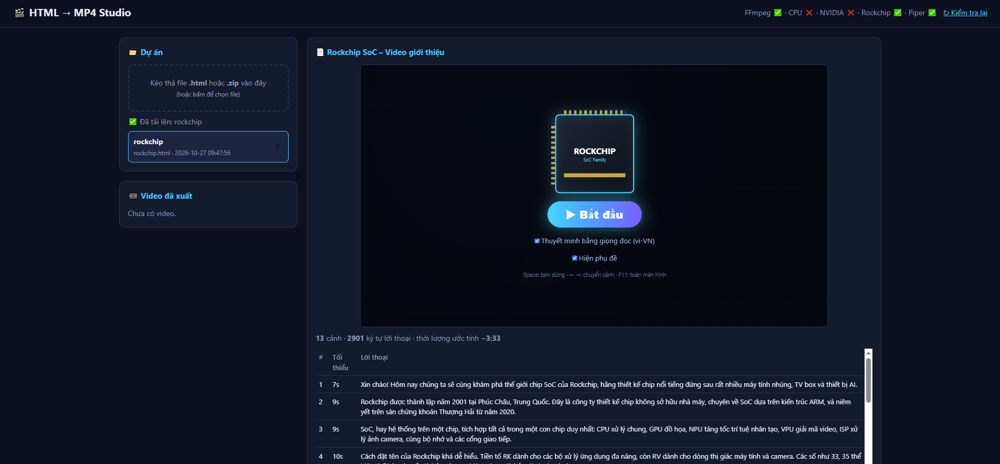
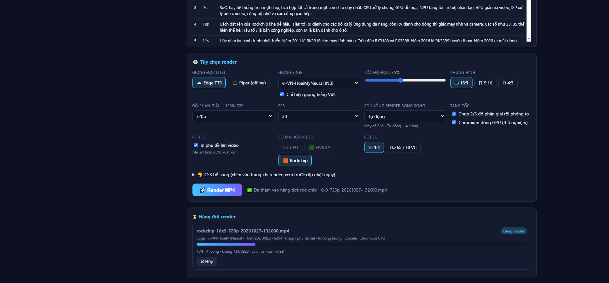
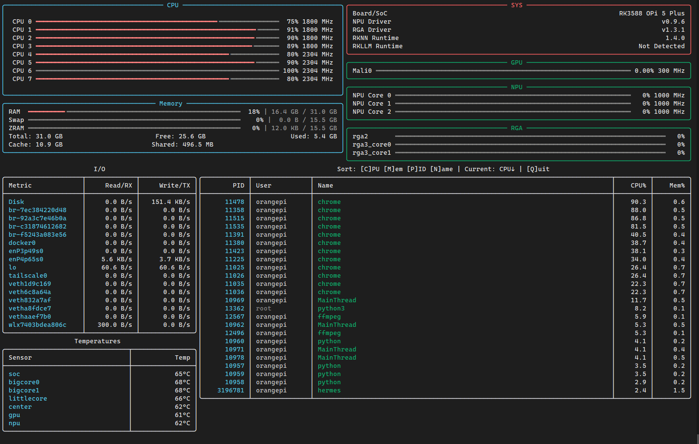
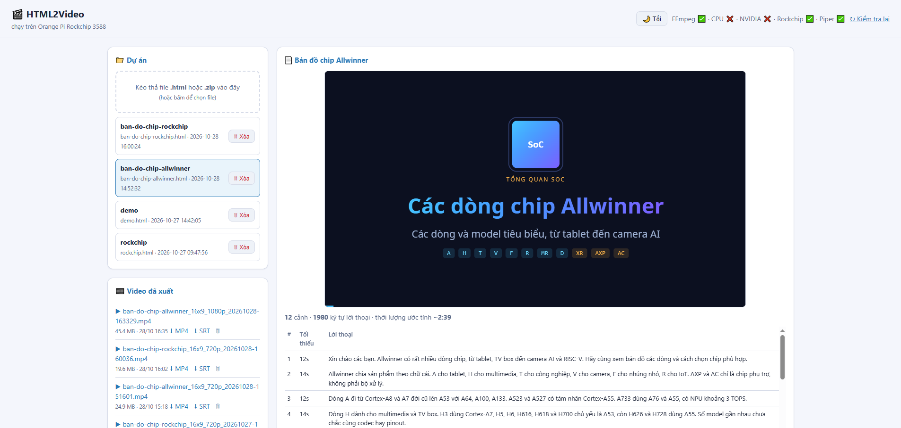
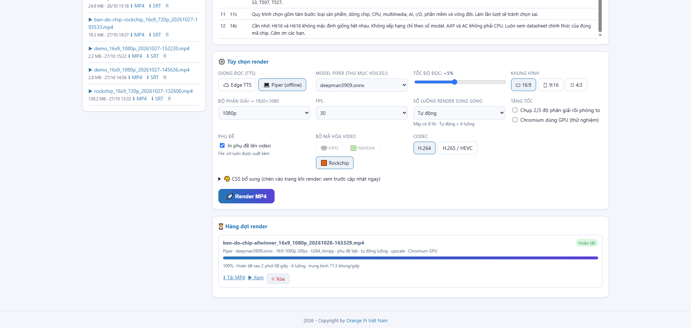

# Screenshot HTML2Video

Ảnh chụp giao diện web. Xem thêm: [README tiếng Việt](README.md) · [English README](README-en.md)

## 1. Giao diện tối — tổng quan

## 2. Giao diện tối — tùy chọn render / TTS

## 3. Giao diện tối — hàng đợi / tiến độ

## 4. Giao diện sáng — tổng quan

## 5. Giao diện sáng — tùy chọn / xuất video

